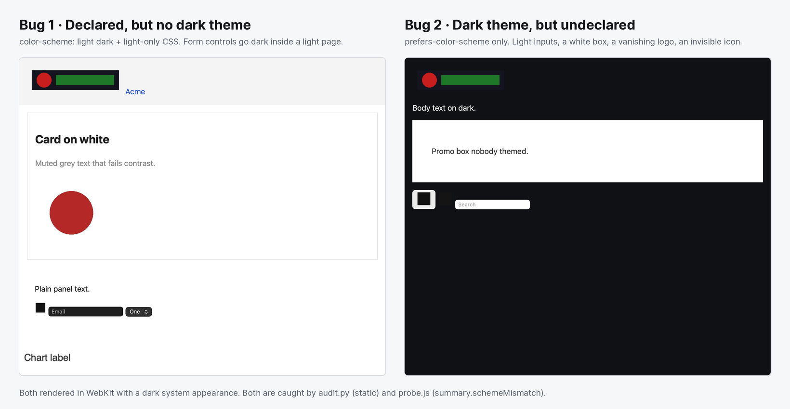

<p align="center">
  
</p>

<h1 align="center">Adaptive Dark Mode Skill</h1>

<p align="center">
  An <a href="https://agentskills.io">Agent Skill</a> that audits a website's theming and makes it ready for
  <a href="https://webkit.org/blog/18541/introducing-adaptive-dark-mode/">Safari's Adaptive Dark Mode</a>.
  It works with Claude Code, Codex, Cursor, GitHub Copilot and any other agent that supports <code>SKILL.md</code>.
</p>

<p align="center">
  <a href="https://github.com/BoughtSpot/adaptive-dark-mode-skill/actions/workflows/ci.yml"></a>
  <a href="LICENSE"></a>
  <a href="https://agentskills.io/specification"></a>
  
</p>

---

Safari 27.3 can **automatically turn light websites dark**. A user with a dark system appearance taps "Try", and Safari inverts lightness, keeps hue, and pushes text to 4.5:1 contrast. It skips any site that declares `color-scheme: light dark`.

That one declaration decides whether Safari repaints your site. Many sites get it wrong in one of two ways, and both look worse than doing nothing:



1. **Declared, but no dark theme.** The declaration switches off Safari's conversion and turns browser-drawn surfaces (form controls, scrollbars, the page canvas) dark, while your hard-coded colors stay light.
2. **Dark theme, but undeclared.** A Tailwind `.dark` class, a `data-theme` toggle, or next-themes with `defaultTheme="light"` looks like an undeclared light site. Safari converts your *light* theme, and the dark theme you built never shows.

This skill teaches your coding agent to find out what Safari will do to a site, decide what it *should* do, and change the code to match, without touching the light theme.

## What it does

- **Explains Safari's behavior.** Everything WebKit has published about Adaptive Dark Mode is condensed into a [facts file](skills/adaptive-dark-mode/references/adm-facts.md), kept separate from a list of open questions so the agent never presents a guess as fact.
- **Chooses a path.** Every site lands on one of three:
  - **A. Own it:** declare dark support and ship a real dark theme.
  - **B. Make it convertible:** clean up what Safari's conversion handles badly.
  - **C. Opt out islands:** `color-scheme: light only` on elements that must not change.
- **Static audit** ([`audit.py`](skills/adaptive-dark-mode/scripts/audit.py)): Python standard library only.
  - Finds declarations, dark-mode mechanisms, default theme, and how much of the color is tokenized.
  - Flags raster logos, dark-on-transparent and white-backed images (pixel checks via Pillow), sprites, tiled backgrounds, masks, blend modes, `filter: invert()` hacks, canvas, iframes, and JavaScript that reads computed colors.
- **Runtime probe** ([`probe.js`](skills/adaptive-dark-mode/scripts/probe.js)): one browser expression, with no dependencies, that never modifies the page.
  - Reports whether the used `color-scheme` matches what the page paints.
  - Also reports WCAG text contrast, light islands on dark pages, invisible icons, vanishing logos, and form controls that don't match the page.
- **Fixes**, applied in [a fixed order](skills/adaptive-dark-mode/references/fix-patterns.md): declaration, theme toggle without a flash, `light-dark()` tokens, UA surfaces, images, canvas and embeds, elevation, brand colors.
- **Framework notes** for Tailwind v3/v4, shadcn/ui, Next.js and next-themes, SvelteKit, Nuxt, Astro, Rails, Bootstrap 5.3, MUI, Chakra, CSS-in-JS and WordPress ([frameworks.md](skills/adaptive-dark-mode/references/frameworks.md)).
- **Verification:** the automated checks, a checklist of pages and states, a flash test, and the steps that only work in real Safari ([verification.md](skills/adaptive-dark-mode/references/verification.md)).

## Install

### Claude Code (plugin)

```text
/plugin marketplace add BoughtSpot/adaptive-dark-mode-skill
/plugin install adaptive-dark-mode@boughtspot
```

### Any agent, with the `skills` CLI

```bash
npx skills add BoughtSpot/adaptive-dark-mode-skill
```

### Manual copy

The skill is the folder [`skills/adaptive-dark-mode/`](skills/adaptive-dark-mode). Copy it into the directory your agent reads skills from:

| Agent | Personal (all projects) | One project (commit it for your team) |
|---|---|---|
| Claude Code | `~/.claude/skills/` | `.claude/skills/` |
| OpenAI Codex | `~/.agents/skills/` | `.agents/skills/` |
| Cursor | `~/.cursor/skills/` | `.cursor/skills/` |
| GitHub Copilot / VS Code | `~/.copilot/skills/` | `.github/skills/` |

Directory conventions are still settling across agents, so check your agent's docs if it doesn't pick the skill up.

```bash
git clone --depth 1 https://github.com/BoughtSpot/adaptive-dark-mode-skill.git
cp -r adaptive-dark-mode-skill/skills/adaptive-dark-mode ~/.claude/skills/
```

## Use it

Ask in plain language. The skill's description is written to trigger on the problem, even when you don't name the skill:

- "Is this site ready for Safari's Adaptive Dark Mode?"
- "Our dark mode looks broken in Safari, with white boxes and the logo disappearing."
- "Add a proper dark theme with a system/light/dark toggle, no flash."
- "Audit our color tokens for dark mode."
- "Opt our charts out of Safari's automatic dark mode."

The agent orients itself in the codebase and runs the audit, then probes the running site if there's a URL or dev server. It recommends a path and asks before any big design change, such as inventing a whole dark palette. Then it fixes things in order, verifies, and writes a report. The report has a verdict, findings by severity with `path:line`, and a list of what you still need to check in Safari.

## Use the scripts without an agent

Both tools work on their own.

```bash
# Static audit: Markdown report (or --json), Python 3.9+, no dependencies
python3 -I skills/adaptive-dark-mode/scripts/audit.py path/to/your/site

# Light + dark probe with screenshots, from a project that has Playwright installed
node skills/adaptive-dark-mode/scripts/probe.mjs http://localhost:3000 --out adm-probe
```

You can also paste `probe.js` into any browser's devtools console after switching the system or emulated color scheme.

Sample audit output, for a Next.js and Tailwind site with a class-based dark mode:

```markdown
## Verdict
- **Under Adaptive Dark Mode today:** converted (dark theme exists but is undeclared)
- A dark theme exists but there's no static declaration. Whenever the site's default render is light,
  Safari converts the light theme and your real dark theme never shows. ...

### [HIGH] Dark theme exists but no static color-scheme declaration (1)
- **Fix:** fix-patterns §1: <meta name="color-scheme" content="light dark"> early in <head> plus :root { color-scheme: light dark; }.

### [MEDIUM] Theme defaults to light instead of system (1)
  - app/layout.tsx:4
```

### Keep it from regressing in CI

`--fail-on high` exits 1 when the audit finds a high-severity problem, such as an undeclared dark theme or a declaration with no dark styles:

```yaml
# .github/workflows/dark-mode.yml
- uses: actions/checkout@v7
- run: |
    curl -fsSL https://raw.githubusercontent.com/BoughtSpot/adaptive-dark-mode-skill/v1.0.0/skills/adaptive-dark-mode/scripts/audit.py -o "$RUNNER_TEMP/adm-audit.py"
    python3 -I "$RUNNER_TEMP/adm-audit.py" . --fail-on high
```

## Limitations

- **Nothing can emulate Adaptive Dark Mode.** It's a Safari feature the user opts into. The probe measures your site's *own* light and dark rendering, and the last check is always a human in Safari 27.3. The skill says this rather than implying otherwise.
- **The audit is heuristic.** It uses regex and simple parsing, not a CSS engine. The skill tells the agent to open each finding's file and confirm it before acting. It can't see CSS-in-JS theme objects, CMS content, or remote stylesheets. The probe covers the rendered result.
- **Safari's behavior is new and in beta.** The facts are from WebKit's [announcement](https://webkit.org/blog/18541/introducing-adaptive-dark-mode/) (Nov 3, 2026, Safari 27.3 beta 1). For example, the `light only` opt-out isn't supported in beta 1. When WebKit publishes more, [`adm-facts.md`](skills/adaptive-dark-mode/references/adm-facts.md) gets updated. PRs with Safari observations are very welcome.

## FAQ

**Will adding `color-scheme: light dark` fix everything?**
No, and adding it alone can make things worse. It's correct only if every color on the site has a dark value. That's the first bug above, and the skill's main rule.

**Can my JavaScript detect Adaptive Dark Mode?**
No. WebKit made it undetectable: `getComputedStyle` returns your authored colors. This matters for canvas charts that read CSS variables. The skill covers it in [fix-patterns §6](skills/adaptive-dark-mode/references/fix-patterns.md).

**Does this help in Chrome and Firefox too?**
Yes. Path A is ordinary, standards-based dark mode (`color-scheme`, `light-dark()`, `prefers-color-scheme`), so the result works in every modern browser.

**Is this affiliated with Apple or WebKit?**
No. It's an independent open-source project that cites WebKit's public documentation.

## Repository layout

```text
skills/adaptive-dark-mode/     the skill (this is what you install)
  SKILL.md                     workflow, decision table, fix order, report template
  references/                  facts and unknowns, fix patterns, framework notes, verification
  scripts/                     audit.py, probe.js, probe.mjs
tests/                         fixtures with known bugs, audit and probe regression tests, spec validator
.claude-plugin/                Claude Code plugin + marketplace manifests
AGENTS.md                      context for coding agents working on this repo
```

## Contributing

Bug reports, false positives, framework notes and Safari observations are all welcome. See [CONTRIBUTING.md](CONTRIBUTING.md). The test suite is `npm test`: Python unittest, the spec validator, and Playwright tests in Chromium and WebKit.

## License

[MIT](LICENSE) © BoughtSpot
